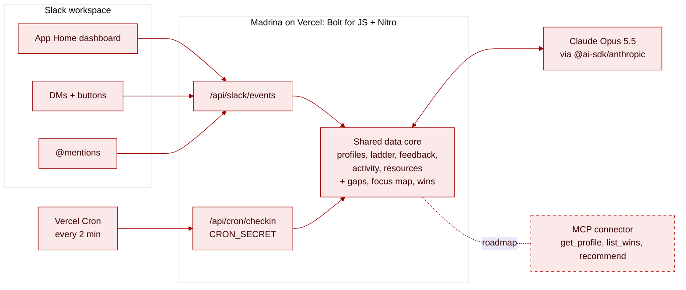

<div align="center">
  
  <h1>Madrina</h1>
</div>

A career coach in Slack for women software engineers, built on Claude. Madrina shows your path to your next level, catches when your work drifts away from what your manager said matters, and turns your wins into promo-ready bullets.

*Madrina* means godmother in Spanish: the woman who vouches for you.

## At a glance 🔎

| | |
| --- | --- |
| **What** | Slack app (App Home, DMs, @mentions) for career growth toward senior, Staff and Principal roles |
| **Goal** | Get more women promoted into senior engineering roles, and make the IC track (Staff, Principal) as normal a path as management |
| **Built at** | Code with Claude: Women in AI Hackathon, Anthropic SF, 2026-11-06 |
| **Built by** | Frances Coronel |
| **Status** | Hackathon demo. Runs locally with the Slack CLI; deploys to Vercel |
| **Data** | 100% synthetic. Ana Rivera, her manager Dana and everyone else in `data/` are made up |
| **Next** | Ships to the [Latina.dev](https://latina.dev) Slack community |

## The problem 📉

Women don't mostly leave tech because of childcare. They leave because they stop moving up.

- **Limited career advancement is the #1 reason women give for leaving tech jobs:** 28% in Indeed's 2018 US survey and 25% in the 2025 Lovelace Report (UK). Childcare comes in at 2 to 3%.
- **Women are 44% more likely to be asked to do non-promotable tasks** (research behind [*The No Club*](https://www.thenoclub.com)). Glue work keeps teams running and rarely shows up in a promo packet.
- **The career advice skews male.** Popular engineering newsletters and podcasts mostly feature men. On the Pragmatic Engineer podcast, fewer than 1 in 5 guests are women.

Promotion is an economic mobility lever: level sets pay, equity and who gets the next big project. Madrina sits where the work already happens, in Slack, and helps a woman see her gaps, protect her focus, get credit for her work and find advice from women who've done it.

## What Madrina does ✨

| Feature | What happens |
| --- | --- |
| 🏠 **App Home dashboard** | Current → target level and track, top 3 gaps (self-assessment vs. a ladder), one resource by a woman author matched to the biggest gap, wins logged, and the support system (mentor, sponsor, advocate, coach) shown as filled or empty |
| 🧭 **Weekly focus check** | Compares what her manager said matters (Gateway) with where her pull requests went (7 of 9 to Billing). If more than half went elsewhere, she gets a DM. It also points out that 6 of the 7 Billing asks came by DM and suggests moving them to a channel so the work is visible |
| ✍️ **Draft a note to my manager** | Claude drafts the note in the thread. Madrina never sends anything to her manager: she drafts, you decide |
| 🗺️ **Plan next week** | A Monday-to-Friday plan around the priority, each day tied to a Staff competency |
| 🏆 **Log a win** | Reply with one line. Claude rewrites it as a promo-ready bullet mapped to a ladder competency, and the App Home count updates |
| 💬 **Coach** | DM or @mention Madrina with a question. Answers use her profile, gaps, focus map and only the curated resource shelf |
| ⏰ **Cron** | A Vercel cron runs the same focus check every 2 minutes, so the nudge shows up on its own |

The IC track and management are treated as equally valid. Madrina never infers anyone's gender.

## Architecture 🏗️



- **Slack app:** Bolt for JS on Nitro with `@vercel/slack-bolt`. Every Slack event, button click and command comes in at `/api/slack/events`.
- **Shared data core:** `server/lib/madrina/` reads the synthetic JSON in `data/`, computes gaps and the focus map, and keeps wins in memory (no database).
- **Claude:** `server/lib/ai/` calls Claude Opus 5.5 (medium effort) through `@ai-sdk/anthropic` to draft the manager note, plan the week, rewrite wins as structured bullets, and coach.
- **MCP connector (roadmap):** the same data core exposed as `get_profile`, `list_wins` and `recommend`, so a personal Claude can read it.

## Quick Start 🚀

You need Node 24+, pnpm, the [Slack CLI](https://docs.slack.dev/tools/slack-cli/), an Anthropic API key and a free [ngrok](https://ngrok.com) authtoken.

```bash
git clone https://github.com/FrancesCoronel/madrina.git && cd madrina
pnpm install
cp .env.example .env
```

Fill in `.env`: `ANTHROPIC_API_KEY`, `NGROK_AUTH_TOKEN`, `SLACK_SIGNING_SECRET` (from your app's Basic Information page), and `ANTHROPIC_WORKSPACE_ID` if your key isn't scoped to a workspace. Then:

```bash
slack login
slack run
```

`slack run` creates the app from `manifest.json`, installs it in the workspace you pick, and tunnels Slack events to your machine. Open Madrina's **Home** tab and click **Run my weekly check-in**.

To deploy, import the repo in Vercel, set the same env vars plus `SLACK_BOT_TOKEN` and a long random `CRON_SECRET`, and point the manifest URLs at `https://<your-app>.vercel.app/api/slack/events`.

Optional: `scripts/seed-slack.ts` fills a workspace with synthetic project channels and 1:1 threads from `data/slack-seed.json`, as a backdrop for the demo.

## Directory Structure 📁

```text
data/              synthetic profiles, ladder, manager feedback, PR activity, resources, Slack seed
server/api/        Slack events endpoint and the cron route
server/lib/ai/     Claude calls: voice, coach context, win rewriting
server/lib/madrina gaps, focus check, in-memory store
server/lib/slack/  Block Kit for App Home, the check-in DM and replies
server/listeners/  Bolt listeners for events, messages, actions, commands
assets/            app icon and custom emoji
```

## Credits 🙏

- Started from Vercel's [Slack Agent Template](https://github.com/vercel-partner-solutions/slack-agent-template) (MIT), which is now deprecated in favor of [Eve Slack Agent](https://vercel.com/templates/eve/eve-slack-agent). Madrina keeps the template's Bolt + Nitro + Vercel setup and swaps its Workflow SDK agent and AI Gateway for direct Claude calls.
- The ladder in `data/ladder.json` is a simplified example inspired by public frameworks ([sdras/career-ladders](https://github.com/sdras/career-ladders), Dropbox). It's not any company's real ladder.
- Every resource Madrina recommends is by women who publicly identify as women: Tanya Reilly, Camille Fournier, Lara Hogan, Sarah Drasner, Cate Huston, Jean Hsu, Julia Evans, Charity Majors, Limor Bergman Gross, the authors of *The No Club*, and the Latina.dev community.

## License

MIT
